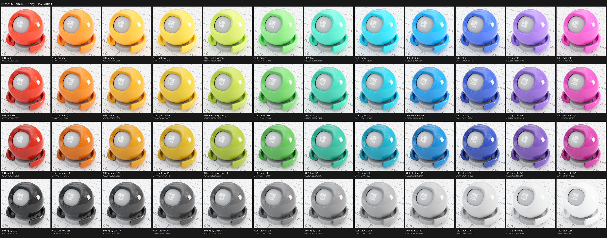
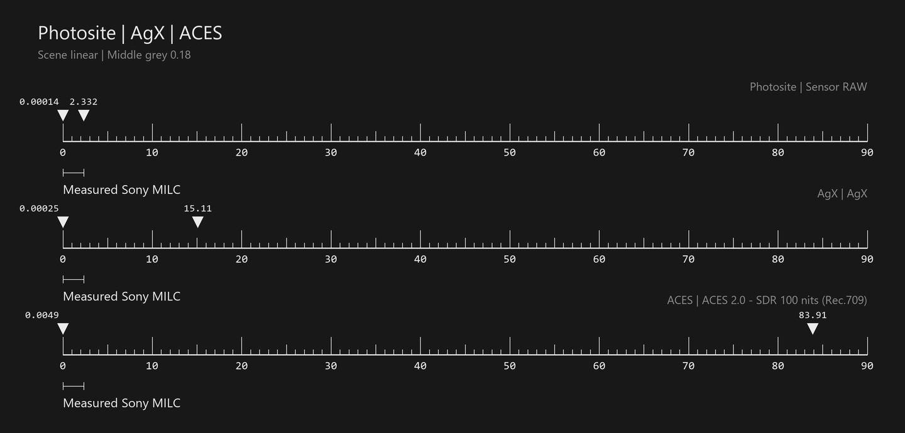
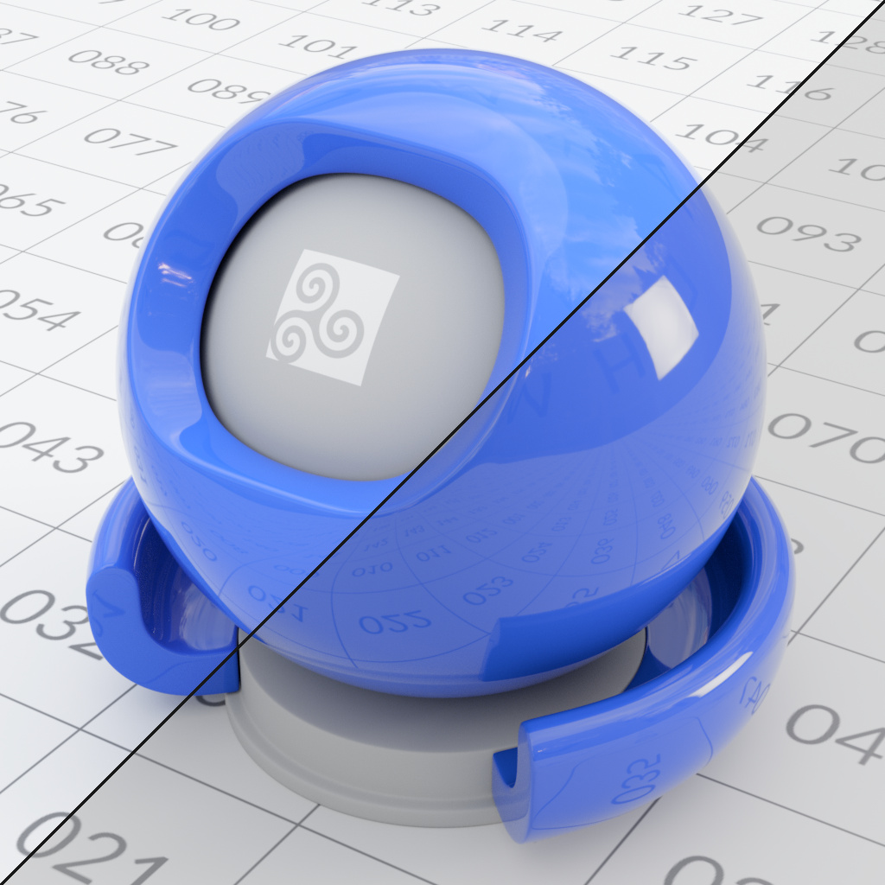
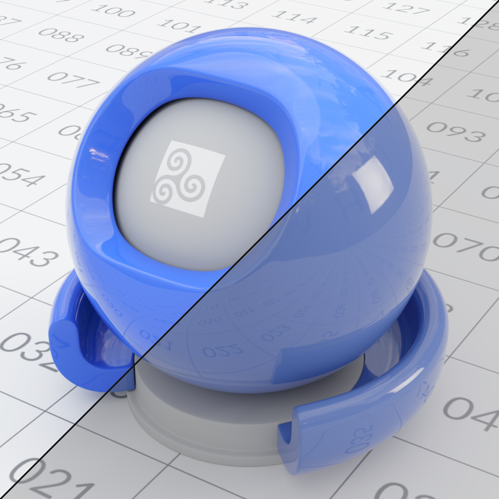
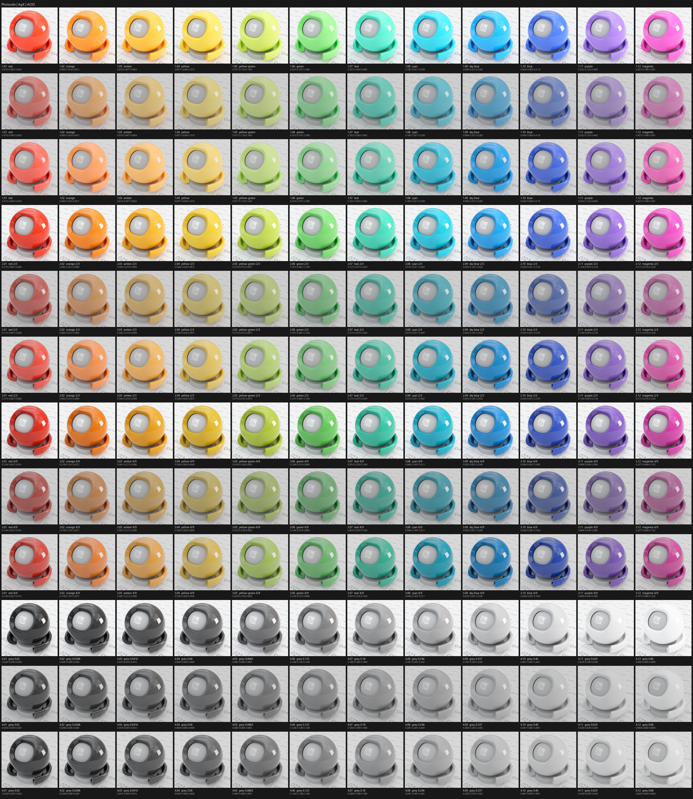
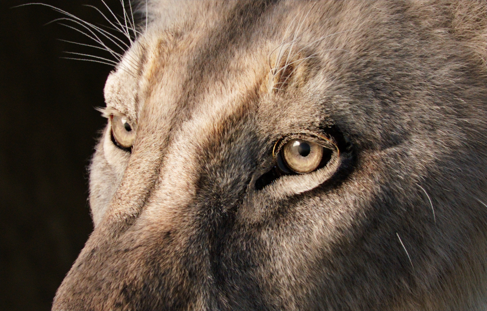
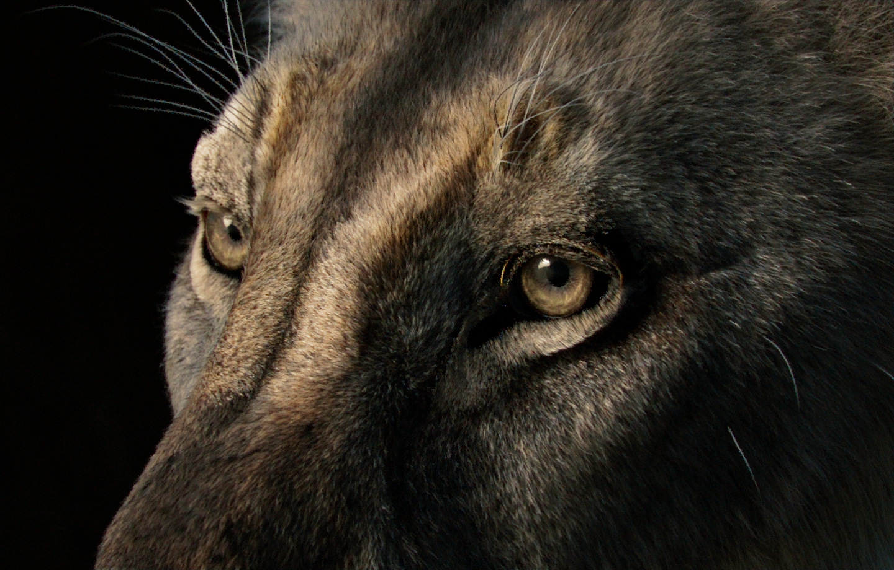
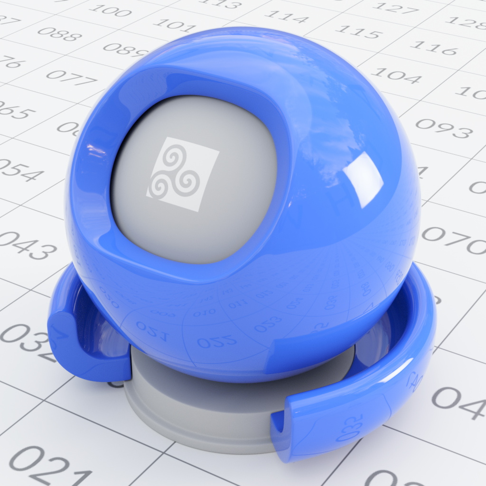
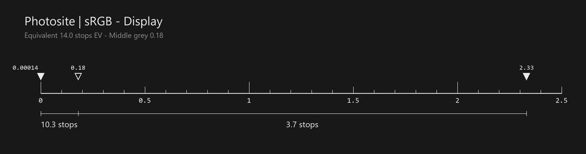
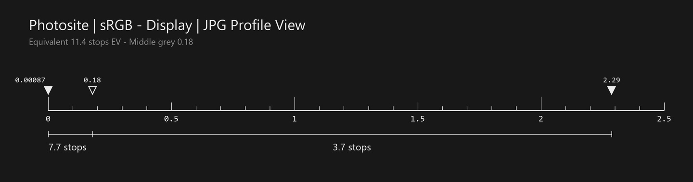

# Photosite

***Notice:*** Although tested and working this is still in its infancy and has not been widely tested in a wide array of situations or use-cases. **Additions and revisions are immanent**.
 
**An OpenColorIO configuration that previews scene-linear CGI as a real stills camera would photograph it.**

Photosite adds photographic views to the stock ACES 2.0 OCIO configuration. Pick a display and a view, and your render is
shown with a mirrorless camera's exposure latitude, clipping points, tone curve and colour rendering, as an unedited
photograph straight out of the camera would look.

Current release: **v0.01.02**. It is available for OCIO 2.5 and OCIO 2.4. Each release folder is self-contained: the
config and its `luts/` folder are all it needs, so older release folders can be kept or deleted freely.

  

<em>The same shader balls shown through <strong>Photosite | sRGB - Display | JPG Portrait</strong>.</em>

---

## Why Photosite exists

ACES and AgX are excellent, and they are built for a different job. Each is designed to carry a very wide dynamic range,
so that images from many kinds of sources, from high-end digital cinema cameras and film scans to CGI, can all be shown
without clipping. ACES 2.0's SDR Rec.709 view reaches display white at about **+8.9 stops** above middle grey, and AgX
is designed around a range of about −10 to +6.5 stops. That generous range is a feature, and it is the right choice for a
great deal of work.

It is not, however, the range of the camera many people are actually using. Consumer and prosumer hybrid
video/photography cameras, and professional DSLR and mirrorless bodies, are more capable and more affordable than ever,
and more commercial and small-studio work is being shot on them. Professional cinema cameras are not going anywhere and
remain heavily used, but they are no longer the automatic choice for every job the way they once were. Most of the
cameras in that growing group cannot capture a range as large as AgX's, and certainly not as large as ACES'.

When the footage or stills you have to match come from one of those cameras, a view with far more range than the camera
has can lead to underinformed decisions while texturing, look developing, lighting and finishing: materials and lights
are judged against headroom the reference camera never recorded.

  

<em>Where each view reaches black and white on the same scene-linear scale (0 to 90, middle grey 0.18). The bracket under each ruler is the measured range of the camera Photosite models.</em>

A real DSLR or mirrorless camera behaves differently. At base ISO its raw green channel clips about **3.7 stops** above
a correctly metered middle grey, and its JPEG picture profiles reach white by that same clip (between about 2.6 and 3.7
stops, depending on the profile). The headroom below grey is also different, and so is the shape of the toe and shoulder
that compress shadows and highlights.

Previews steer your decisions when developing or compositing a shot. When the view has more headroom than the camera the
work has to match:

- lights can get set brighter than a photographer would set them, because nothing appears to clip;
- highlight colours sit where a camera would already have desaturated or clipped them;
- shadow and highlight placement relative to middle grey drifts away from real photographs;
- matching photographic references and plates becomes harder, in a scene-referred grade and in a display-referred
  finish.

The usual root cause is misalignment: colour positions and light intensities are judged against a dynamic range the
target camera does not have. Photosite instead places scene-linear values relative to the camera's own middle grey and
clipping points. What you light and grade against is what that camera would have recorded.

  
  

<em>The same render, matched at middle grey. Upper left is Photosite; lower right is ACES 2.0 SDR (left image) and AgX (right image). Each shows the scene faithfully for its own purpose; they differ in how much of the highlight range is kept before white.</em>

Neither side of those splits is wrong. They answer different questions: ACES and AgX keep as much of the scene as they can,
and Photosite shows what a particular class of camera would have recorded. Photosite is designed to reproduce still-camera
behaviour and entry-level prosumer hybrid photo/video cameras. It is not intended for a pipeline built around high-end
film or cinema cameras, where the stock ACES and AgX views remain the better fit.

OCIO is not about being a LUT or being pretty. It is about creating a level playing field for everyone in a pipeline,
a shared baseline for making decisions. Photosite offers that baseline for work that has to live next to real stills-camera
photographs.

  

<em>The same 48 shader balls through Photosite, AgX and ACES 2.0 SDR (rows alternate in that order), matched at middle grey.</em>

## Intended use

- **Lighting and look development:** previewing CGI as it would come out of a stills camera at base ISO.
- **Product, still-life and architectural rendering:** work meant to look like photography, not cinema.
- **Matching photographic references:** CG that must sit next to, or be graded with, real photos from similar cameras.
- **Exposure discipline:** a scene metered to 0.18 middle grey clips where a camera would.

The views are **previews of an unedited photograph**: the camera's JPEG picture profile with no adjustments. They are not
a final grade. Keep rendering and saving scene-linear (ACEScg EXR) data, and grade from that.

  
  

<em>Left: the unedited photograph, <strong>JPG Standard</strong>. Right: the same scene-linear image after a grade. The view is the starting point, and the grade is applied afterwards.</em>

## The camera model

The camera model is a hybrid: data measured on Sony mirrorless cameras, combined with additional research. It represents a
modern single-ISO full-frame CMOS mirrorless camera at base ISO.

---

## Views

| View | LUT | Character |
| --- | --- | --- |
| **JPG Standard** | `camera_standard.cube` | the camera's default rendering, refined against the camera's own JPEGs of real daylight scenes (default view) |
| **JPG Neutral** | `camera_neutral.cube` | lower contrast and saturation |
| **JPG Vivid** | `camera_vivid.cube` | higher saturation and contrast |
| **JPG Clear** | `camera_clear.cube` | clean, bright highlights |
| **JPG Deep** | `camera_deep.cube` | dense, darker rendering |
| **JPG Light** | `camera_light.cube` | bright, airy rendering |
| **JPG Portrait** | `camera_portrait.cube` | soft rendering for skin tones |
| **JPG Landscape** | `camera_landscape.cube` | saturated greens and blues |
| **JPG Monochrome** | `camera_monochrome.cube` | black and white |
| **JPG Sepia** | `camera_sepia.cube` | sepia-toned monochrome |
| **Sensor RAW** | — | the sensor's linear data, for inspection |
| **False Color** | `false_color.spi1d` | exposure bands on the sensor's scale |

The JPG views are added to every display. Sensor RAW and False Color are added to every display except the
gamut-compressed ones.

### JPG views

Each JPG view shows the photograph the camera's picture profile produces, with white balance set to D65 and no
adjustments. Each view does the following, in order:

1. Converts the scene to the camera's white-balanced sensor RGB.
2. Clips each channel at the sensor's real saturation point.
3. Applies the picture profile, stored as a 65³ camera-RGB lattice.
4. Converts the result to the selected display with relative-colorimetric clipping.

Each profile's colour response and exposure-dependent colour shifts are included, and the neutral tone is the camera
JPEG's own measured curve at every exposure: scene 0.18 renders as the camera's middle grey, whites clip where the camera's
JPEG whites clip, and blacks go to code 0 where the camera's do. Nothing is brighter after the sensor's green clip: a
neutral past it is plain white, as in the camera's JPEG, and there is no extra highlight or shadow detail.

The camera writes the same tone codes in its sRGB and Adobe RGB JPEG modes, so each display shows the camera's codes
exactly: the sRGB and Rec.1886 displays use the sRGB-mode lattices, every other display the Adobe RGB-mode ones. The view
names are the same everywhere.

  

<em>A glossy blue shader ball through a JPG view: saturated colour, and highlights that clip as they would in the camera's JPEG.</em>

**JPG Sepia** is the camera's own Sepia look: its three channel curves, a warm brown at middle grey (CIELAB hue about 47°),
a slightly tinted white in the brightest highlights and a dark red-brown black, all as the camera records them.

### Sensor RAW

This view shows the sensor's data in scene-linear form. Each channel is clipped at its real saturation point for a D65
white balance, and nothing else is applied: no tone curve and no exposure gain. Scene 0.18 shows as display-linear 0.18.

Use it to see exactly where the sensor clips. The green channel clips first. Between the green clip and the red and blue
clips, unprocessed highlights turn pink, as they do in a real undeveloped raw file. This is an inspection view and is not
meant to be viewed as a photograph.

### Stock views

These are kept from the ACES 2.0 configuration:

- `ACES 2.0 - SDR 100 nits (Rec.709)` and the matching ACES 2.0 views for each display;
- `Un-tone-mapped`;
- `Video (colorimetric)`;
- `Raw` (data passthrough, always listed last).

---

## Dynamic range relative to middle grey

All values are in stops relative to scene **0.18**, at base ISO with D65 white balance.

  

<em><strong>Sensor RAW:</strong> the sensor's own range, 14.0 stops from the noise floor to the green clip.</em>

  

<em><strong>JPG Portrait:</strong> the rendered range of a JPEG profile, 11.4 stops. Black is where the profile's tone curve reaches 8-bit code 0, white is where a neutral reaches code 255.</em>

| | Stops over 0.18 |
| --- | --- |
| Raw green clip | **+3.70** |
| Raw blue clip | +4.13 |
| Raw red clip | +5.11 |
| JPG Standard reaches white | **+3.69** (the green clip) |
| JPG Standard reaches black (8-bit code below half) | about −8.1 |
| Sensor noise floor (signal equals noise) | −10.3 |
| *ACES 2.0 SDR (Rec.709) reaches white, for comparison* | *about +8.9* |

- **Raw clips:** where each sensor channel saturates. Green has the least headroom because of the camera's white balance
  gains.
- **JPG views reach white:** the scene level at which a neutral surface reaches display white (8-bit code 255), by the
  green clip for most profiles (+3.6 to +3.7), earlier for Light (+3.6), Monochrome (+3.4) and Clear (+2.6).
- **Shadows:** the JPG views reach code 0 (below half an 8-bit code) between about 6.3 stops below grey (Clear) and 8.8
  (Portrait); JPG Standard at about 8.1. Deeper values are black.
- **Middle grey:** the camera's own middle-grey code: scene 0.18 renders at about sRGB code 119.6 in JPG Standard
  (118 to 130 in the other profiles).

---

### False Color

An exposure tool in the style of a field-monitor false-colour display, measured on the camera's sensor, not on a video
signal:

- **100 %** is the sensor's white clip, +3.70 stops over 0.18.
- **50 %** is middle grey, 0.18.
- **0 %** is the sensor's noise floor, the level where signal equals noise, 10.3 stops under 0.18.

The signal is the brightest sensor channel relative to its own saturation. For a neutral surface this is simply its
exposure, and a strongly coloured highlight turns red as soon as any one channel clips. Each band is a solid plateau, with
a smooth S-curve transition into the next.

| Colour | Signal | Stops relative to 0.18 | Meaning |
| --- | --- | --- | --- |
| Red | 100 % and over | +3.70 and over | clipped: at least one sensor channel has no data left |
| Orange | 93–100 % | +3.18 to +3.70 | the last half stop before clipping |
| Yellow | 84–93 % | +2.52 to +3.18 | bright highlights |
| Pale yellow | 77–84 % | +2.00 to +2.52 | highlights; white materials under the key light |
| Light grey | 58–77 % | +0.59 to +2.00 | bright midtones |
| Pink | 54–58 % | +0.30 to +0.59 | just over middle grey (bright skin tones) |
| Grey | 47–54 % | −0.62 to +0.30 | middle grey |
| Green | 43–47 % | −1.44 to −0.62 | just under middle grey |
| Dark grey | 24–43 % | −5.36 to −1.44 | shadows |
| Teal | 15–24 % | −7.21 to −5.36 | deep shadows, near the JPG views' black |
| Blue | 8–15 % | −8.65 to −7.21 | very deep shadows, noisy |
| Navy | 2–8 % | −9.89 to −8.65 | about to reach the noise floor |
| Purple | under 2 % | under −9.89 | at or below the noise floor: no usable data |

Above middle grey a band step is small: 10 % is about 0.74 stops. Below middle grey it is wider, about 2.1 stops per
10 %, because the sensor holds about three times as many stops under grey as over it. The JPG views reach black between
−6.3 and −8.8 stops, before the sensor runs out of data, so teal and below show shadow data that a JPG photograph would crush.

## Displays

| Display | Notes |
| --- | --- |
| sRGB - Display | default |
| AdobeRGB - Display | Adobe RGB (1998) primaries, 2.2 power |
| Display P3 - Display, P3-D65 - Display | |
| Rec.1886 Rec.709 - Display | |
| Display P3 HDR - Display, Rec.2100-PQ - Display, Rec.2100-HLG - Display, ST2084-P3-D65 - Display | HDR; the JPG views are SDR photographs shown within the HDR signal |
| `<display> (gamut compressed)` | sRGB, Rec.1886 Rec.709, Display P3, P3-D65 and AdobeRGB |

**Gamut-compressed displays.** The JPG views normally clip colours outside the display gamut, as a photographic export
does. Each `(gamut compressed)` display compresses them into gamut instead, which keeps saturated lights and highly
chromatic materials from posterizing. It uses the ACES 1.3 gamut compressor in the display's primaries, with limits set
from ACEScg content passed through the JPG views. These displays carry only the JPG views.

---

## Colour spaces and roles

**Reference and working spaces:**
- ACES2065-1 is the reference.
- ACEScg is the working, rendering and compositing space.
- ACEScct and ACEScc are provided for grading.

**Other scene-linear inputs:** Linear Rec.709 (sRGB), Linear Rec.2020, Linear P3-D65, Linear AdobeRGB and CIE XYZ-D65.
Use these if your textures or plates are in another linear space.

**Encoded texture spaces:**
- sRGB Encoded Rec.709 (sRGB), sRGB Encoded P3-D65 and sRGB Encoded AP1;
- Gamma 1.8, 2.2 and 2.4 Encoded Rec.709;
- Gamma 2.2 Encoded AP1 and Gamma 2.2 Encoded AdobeRGB.

**Data:** Raw, for non-colour data.

**Key roles:**

| Role | Colour space |
| --- | --- |
| `scene_linear`, `rendering`, `compositing_linear`, `default_float` | ACEScg |
| `reference`, `aces_interchange` | ACES2065-1 |
| `color_timing`, `compositing_log` | ACEScct |
| `color_picking`, `texture_paint`, `default_byte` | sRGB Encoded Rec.709 (sRGB) |
| `data` | Raw |

Roles for Substance 3D Painter's bitmap import and export are included.

**Viewing rules.** Scene-linear and log images are offered the JPG views. Display-encoded images (sRGB, video) are offered
the video views, so a texture is never shown through a camera curve by mistake.

## File rules

Colour spaces are assigned from file names. The first match wins:

1. **A token right before the extension.** For example, `wood_albedo_ACEScg.tx` reads as ACEScg and `plate_lin_rec709.exr`
   as Linear Rec.709. Recognised tokens include `raw`, `data`, `noncolor`, `acescg`, `lin_ap1`, `aces2065_1`, `lin_ap0`,
   `acescct`, `acescc`, `lin_rec709`, `lin_srgb`, `lin_rec2020`, `lin_p3d65`, `lin_adobergb`, `cie_xyz_d65`, `srgb`,
   `srgb_p3d65`, `srgb_ap1`, `g18_rec709`, `g22_rec709`, `g24_rec709`, `rec1886`, `g22_ap1` and `adobergb`.
2. **The same tokens anywhere in the file name.**
3. **PBR data maps read as Raw.** These include normal, bump, height, displacement, roughness, glossiness, metallic,
   ambient occlusion, cavity, curvature, thickness and anisotropy maps.
4. **A folder named by a token,** for example `textures/srgb/wood.png`.
5. **Mip containers keep the encoding of their source.** For example, `wood.png.tx` reads as sRGB and `sky.exr.tx` as
   ACEScg.
6. **Defaults by file type:**
   - 8-bit image formats (png, jpg, tif, tga, psd and so on) read as sRGB;
   - `.exr` reads as ACEScg;
   - `.hdr` reads as Linear Rec.709;
   - movies read as Gamma 2.4 Rec.709;
   - anything else reads as ACEScg.

---

## Exposure and scene setup

Photosite assumes **0.18 is middle grey as the camera's meter would place it**. To get camera-like results:

- **Meter the scene.** Set the camera or lighting so that an 18 % grey card lit by the key light reads 0.18 in ACEScg.
- **Use physically plausible albedos.** Real white paper is about 0.8 to 0.85, not 1.0. A perfect-white diffuser at
  1.0 under the key light lands about 2.5 stops over grey: brighter than any real white material.
- **Let lights and speculars clip.** With an ordinary metered exposure, a white surface sits comfortably below the
  sensor's green clip, about 3.7 stops over grey. Light sources, sun glints and strong speculars go past it, exactly as
  they do in a photograph.
- **Check exposure with False Color.** Grey marks middle grey, orange the last half stop before clipping, and red clipped
  data. Switch to Sensor RAW to see the clipped channels themselves.

## Compatibility

- **Tested:** both configs validate and render identically under OpenColorIO 2.5.2 and 2.4.2, on CPU and GPU (GLSL).
  Testing was performed in BMD Fusion Studio and Houdini.
- **Other applications:** any application with OCIO 2.4 or newer can load the matching config.
